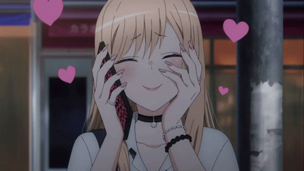
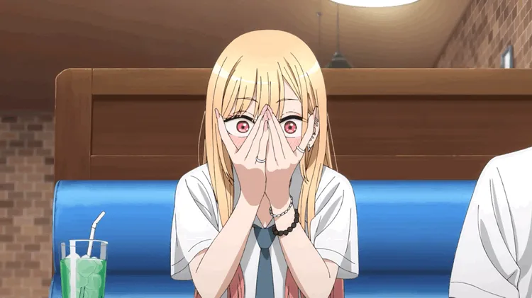

  

### ˚₊‧꒰ა a little data, a little design, a lot of curiosity ໒꒱‧₊˚

B.S. Data Science Student · Creative Director · AI Studio Fellow  
Project Manager & Documentation Lead · Interactive Storyteller

**🥇 1st Place Nationally — AIS SCLC 2026**

୨୧ ──────────── ♡ ──────────── ୨୧

## 🌷 who i am

I'm Maria, a **Data Science student at Metropolitan State University**, also pursuing a **Certificate in Intelligence and Security Analysis**. I enjoy connecting data, AI, design, and storytelling.

I'm a **Project Manager & Documentation Lead for Break Through Tech AI Studio**, a **SCALE student worker**, and **Creative Director, Copy Editor & Technology Reporter at The Metropolitan**. As **Marketing Officer for Girls Who Code Collegiate Loop**, I also help connect students with community and opportunities in technology.

I enjoy shaping ideas into things people can understand and use: a machine learning project, an intuitive interface, a visual identity, or a story that makes technology feel approachable. My interests span **applied AI, UX/UI design, intelligence and security analysis, project coordination, and visual storytelling**.

Outside of school and work, you'll find me designing pastel visuals, experimenting with creative technology, and developing **Lil’ Jammies**, my original character world and interactive story game built in **Twine**. ♡

  
  &nbsp;&nbsp; ♡ &nbsp;&nbsp;
  

<i>learning, creating, and getting a little excited about every new idea ♡</i>

## 🎓 what i'm studying

**Metropolitan State University**

- **B.S. in Data Science** — in progress; expected Spring 2027
- **Certificate in Intelligence and Security Analysis** — in progress

## 🪻 what i'm working on

- **Project Manager & Documentation Lead · Break Through Tech AI Studio** — coordinating team milestones and leading documentation for an Abt Global project exploring LLM-assisted migration of legacy SAS workflows to Python, including validation and migration documentation. [Explore the project ↗](https://github.com/Break-Through-Tech/Abt-Global-1B-ai-powered-sas-migration)
- **SCALE Student Worker · Metropolitan State University** — expanding my knowledge of hardware security, AI, and semiconductor technologies through technical training and nanoHUB micro-certificates.
- **Creative Director, Copy Editor & Technology Reporter · The Metropolitan** — developing visual direction and brand assets, creating promotional designs, editing articles, and reporting on technology.
- **Marketing Officer · Girls Who Code Collegiate Loop** — supporting outreach, promoting events and opportunities, and helping build an inclusive community for women and nonbinary students in technology.
- **Lil’ Jammies · Personal creative project** — developing an interactive story game in Twine alongside original characters, worldbuilding, and experiments with AI-assisted visuals and animation.
- **Data science coursework & projects** — continuing to develop my skills in statistical analysis, machine learning, SQL, and data visualization.

## 🏆 a project i'm proud of

### Insight Talent AI

**🥇 1st Place — 2026 AIS Student Chapter Leadership Conference**  
EY AI-Driven Talent Optimization Challenge · Team Insight Agents

An AI-powered talent optimization platform focused on explainable matching, privacy, and human-centered decision support.

My contributions focused on **UX/UI design, product strategy, user workflows, explainability and governance research, and leading the final presentation**. I helped shape how users navigate the platform and understand its recommendations.

The platform brought together semantic matching, resume redaction, “Why this match?” explanations, audit logs, and career guidance.

`UX/UI Design` · `Product Strategy` · `User Workflows` · `Explainable AI` · `AI Governance`

[Watch the project demo ↗](https://youtu.be/4NGbAYW9_mU)

## 📂 selected data projects

| Project | What I explored | Tools |
| --- | --- | --- |
| [Airbnb Price Classification](https://github.com/Mlars290/airbnb-price-classification-ml) | Classifying 28,000+ listings using preprocessing, feature engineering, and model evaluation | Python, pandas, scikit-learn, TensorFlow |
| [Audio Environment Study](https://github.com/Mlars290/study-focus-audio-portfolio) | Focus and productivity across 87 study sessions; published undergraduate research | R, ggplot2, ANOVA, Tukey HSD |
| [Sleep Duration Analysis](https://github.com/Mlars290/sleep-duration-statistical-analysis) | Relationships between stress, BMI category, and sleep duration | Statistical analysis, two-way ANOVA, visualization |

୨୧ ──────────── ♡ ──────────── ୨୧

## 🎮 Lil’ Jammies

**An original fantasy world and interactive story game, currently in development.**

I'm building **Lil’ Jammies in Twine**, exploring the story of Celestial, Stellion, and Bitterwish through interactive scenes and branching choices. The project brings together my interests in storytelling, character design, game experiences, and creative technology.

My work includes **narrative planning, dialogue, worldbuilding, character concepts, and interactive story structure**, alongside experiments with AI-assisted visuals and animation.

`Twine` · `Interactive Fiction` · `Branching Narratives` · `Worldbuilding` · `Visual Storytelling`

## 🎨 my creative side

I like helping brands and communities communicate through **consistent visuals, clear messaging, and thoughtful experiences**.

- Visual identity, social media graphics, promotional content, and presentation design
- UX/UI design, product storytelling, and community experiences
- Technology reporting, copy editing, and making complex ideas approachable
- AI prompting and creative workflow experiments with **ComfyUI**
- Original characters, interactive stories, and worldbuilding for **Lil’ Jammies**

## 🧰 tools & skills

| Area | My toolkit |
| --- | --- |
| Data & analysis | Python, SQL, R, Excel, pandas, NumPy, statistical analysis |
| Business intelligence & visualization | Tableau, SAP Analytics Cloud, Excel pivot tables and filters, data visualization |
| Machine learning & AI | scikit-learn, TensorFlow, Keras, preprocessing, model evaluation, AI prompting |
| Project management & documentation | Team coordination, milestone planning, technical documentation, research synthesis, presentations |
| Creative direction & communication | Canva, visual identity, content design, presentation design, copy editing, technology reporting |
| Product & experience design | UX/UI design, product strategy, user workflows, explainability, product storytelling |
| Interactive storytelling & games | Twine, branching narratives, interactive fiction, character development, worldbuilding |
| Creative technology | ComfyUI, AI-assisted visuals, animation experiments |
| Development & workflow | Git, GitHub, Jupyter, Google Colab, PostgreSQL, HTML/CSS |

  

<i>soft colors, big ideas, and a folder full of things i want to make ✧</i>

## 💌 let's connect

I'm interested in projects that bring together **data, AI, creativity, and people**. I love making complex ideas easier to understand—and giving useful things a little personality.

[LinkedIn](https://www.linkedin.com/in/mlars29) · [Technology writing](https://themetropolitan.metrostate.edu/tag/maria-larson/) · [Published research](https://metroworks.metrostate.edu/student-scholarship/22/)

<i>curious mind. creative heart. always making something. ✧</i>

  

